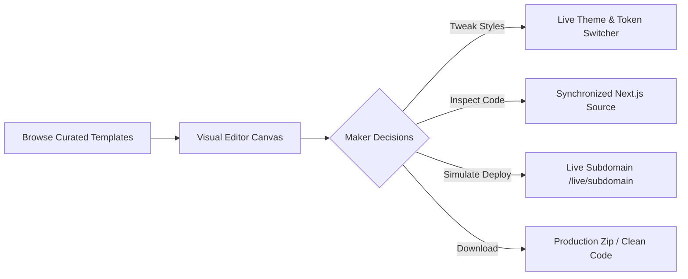

<div align="center">

  

  # ⚡ Launchly

  ### **Websites, curated templates, visual editor, and clean Next.js code — all on one screen.**

  <p align="center">
    A high-performance, open-source maker workspace built for designers, developers, and founders. <br/>
    Customize every pixel visually in real-time, inspect responsive breakpoints, and export production-ready Next.js 15 source code without context switching.
  </p>

  <p align="center">
    <a href="https://github.com/simplyvardaan/Launchly/stargazers"></a>
    <a href="https://github.com/simplyvardaan/Launchly/network/members"></a>
    <a href="https://github.com/simplyvardaan/Launchly/blob/main/LICENSE"></a>
    <a href="https://nextjs.org"></a>
    <a href="https://react.dev"></a>
    <a href="https://tailwindcss.com"></a>
    <a href="https://www.typescriptlang.org"></a>
  </p>

  <p align="center">
    <a href="#what-is-launchly">Overview</a> •
    <a href="#features">Features</a> •
    <a href="#curated-templates">Templates</a> •
    <a href="#live-maker-workspace">Maker Workspace</a> •
    <a href="#quick-start">Quick Start</a> •
    <a href="#tech-stack">Tech Stack</a> •
    <a href="#api-reference">APIs</a> •
    <a href="CONTRIBUTING.md">Contributing</a>
  </p>

</div>

---

<a id="what-is-launchly"></a>
## ⚡ What is Launchly?

Traditional website builders trap you in proprietary closed gardens with messy, unmaintainable code exports. Traditional coding requires hours of boilerplate setup before seeing a single button on screen.

**Launchly bridges the gap:**
1. **Browse curated, award-winning templates** inspired by modern design trends (Awwwards, Godly, Linear, Raycast, brutalism, and editorial luxury).
2. **Fine-tune visually** with in-browser typography, color palettes, spacing, and layout controls.
3. **Simulate live subdomains** (`/live/[subdomain]`) with instant mockup deployment.
4. **Export 100% clean Next.js 15 source code** — zero vendor lock-in, zero runtime bloat.

---

<a id="features"></a>
## 🌟 Key Features

| Feature | Description |
|---|---|
| 🎨 **Curated Aesthetic Templates** | Handcrafted templates across **SaaS, AI, Agency, Portfolio, Ecommerce, Web3, and Media** with responsive layouts and micro-interactions. |
| 🎛️ **Visual Design Canvas** | Real-time sliders and toggles for background themes, primary accents, font scales, radii, and container padding. |
| 📱 **Responsive Viewport Switcher** | Instant preview toggle across **Desktop (1440px)**, **Tablet (768px)**, and **Mobile (375px)** device frames. |
| ⚡ **Live Code & Canvas Split** | Interactive dual-pane maker workspace displaying rendered UI on one side and live Next.js JSX code on the other. |
| 🌐 **Simulated Cloud Publishing** | Launch instantly to a simulated high-speed subdomain (e.g., `yourapp.launchly.site`) with built-in analytics preview. |
| 📦 **Production Code Export** | Download or copy production-ready TypeScript + Tailwind v4 components ready to deploy to Vercel, Netlify, or Cloudflare. |
| 🌗 **Neo-Brutalist & Dark Mode** | High-contrast tactile borders, bold retro drop shadows, smooth spring animations, and full dark mode support. |
| 🔌 **Full-Stack REST Endpoints** | Built-in App Router API routes for auth sessions, newsletter captures, contact forms, template queries, and mock checkout. |

---

<a id="curated-templates"></a>
## 🎨 Curated Templates

Launchly comes bundled with ready-to-use, production-grade template architectures:

```
┌─────────────────┬───────────┬─────────────────────────────────────────────────────────┬──────────────┐
│ Template        │ Category  │ Aesthetic Highlights                                    │ Tech Stack   │
├─────────────────┼───────────┼─────────────────────────────────────────────────────────┼──────────────┤
│ Agenn AI        │ AI        │ Holographic graphs, prompt playground, token telemetry  │ Next.js + TS │
│ Fabrica Studio  │ Agency    │ Kinetic project reels, brutalist Swiss typography       │ Next.js + TS │
│ Chronicle OS    │ SaaS      │ Linear/Raycast dark glass telemetry, live incident radar│ Next.js + TS │
│ Atelier Maison  │ Ecommerce │ Architectural luxury lookbook, sculptural slide-out cart│ Next.js + TS │
│ Noora Studio    │ Agency    │ 3D device staging, fluid hover transitions, client ROI  │ Next.js + TS │
│ Solstice Defi   │ Web3      │ Neon candlestick depth charts, algorithmic orderbook    │ Next.js + TS │
│ Sora Cinema     │ Media     │ 2.39:1 anamorphic widescreen showreel, golden hour glow │ Next.js + TS │
│ Strata Cloud    │ SaaS      │ Interactive edge latency globe, sub-second CLI pipeline │ Next.js + TS │
│ Elian Portfolio │ Portfolio │ Dark editorial layout, micro-motion case studies        │ Next.js + TS │
└─────────────────┴───────────┴─────────────────────────────────────────────────────────┴──────────────┘
```

---

<a id="live-maker-workspace"></a>
## 🕹️ Live Maker Workspace

Launchly features an all-in-one interactive playground (`/live` and `/editor/[templateId]`):



---

<a id="tech-stack"></a>
## 🛠️ Tech Stack

Launchly is built on the modern React and Next.js ecosystem:

- **Framework**: [Next.js](https://nextjs.org) (App Router, Server & Client Components)
- **UI Library**: [React 19](https://react.dev)
- **Styling**: [Tailwind CSS v4](https://tailwindcss.com) + Custom CSS Variables & Neo-Brutalist design tokens
- **Typography**: [Space Grotesk](https://fonts.google.com/specimen/Space+Grotesk) & [Space Mono](https://fonts.google.com/specimen/Space+Mono) via `next/font`
- **Animations**: [Framer Motion](https://www.framer.com/motion/)
- **Primitives**: [Radix UI](https://www.radix-ui.com) (Dialog, Tooltip, Dropdown, Slider, Switch, Tabs)
- **State Management**: [Zustand](https://zustand-demo.pmnd.rs)
- **Icons**: [Lucide React](https://lucide.dev)
- **Type Safety**: [TypeScript](https://www.typescriptlang.org)

---

<a id="quick-start"></a>
## 🚀 Quick Start

Get a local instance of Launchly up and running in under two minutes:

### 1. Prerequisites
Make sure you have:
- **Node.js**: `v18.18+` or `v20+`
- **npm**, **pnpm**, **yarn**, or **bun**

### 2. Clone the Repository
```bash
git clone https://github.com/simplyvardaan/Launchly.git
cd Launchly
```

### 3. Install Dependencies
```bash
npm install
# or
pnpm install
# or
bun install
```

### 4. Setup Environment Variables
```bash
cp .env.example .env.local
```

### 5. Launch the Development Server
```bash
npm run dev
```

Open [**http://localhost:3000**](http://localhost:3000) in your browser to start exploring!

---

## 📜 Available Scripts

| Script | Command | Purpose |
|---|---|---|
| **Development** | `npm run dev` | Runs the Next.js development server with TurboPack and hot-reload |
| **Production Build** | `npm run build` | Compiles and optimizes the application for production deployment |
| **Start Production** | `npm run start` | Runs the compiled production server locally |
| **Lint** | `npm run lint` | Runs ESLint to check for syntax and style issues |

---

## 📂 Project Structure

```bash
Launchly/
├── .github/                     # Issue templates & PR guidelines
│   ├── ISSUE_TEMPLATE/
│   │   ├── bug_report.md
│   │   └── feature_request.md
│   └── PULL_REQUEST_TEMPLATE.md
├── public/                      # Static brand assets, logos, and mockups
│   ├── brand-logo-clean.png
│   ├── brand-name-dark.png
│   └── brand-name-light.png
├── src/
│   ├── app/                     # Next.js App Router routes & endpoints
│   │   ├── api/                 # REST APIs (auth, newsletter, sites, contact)
│   │   ├── dashboard/           # User project management dashboard
│   │   ├── editor/              # In-browser visual customizer & canvas
│   │   ├── live/                # Simulated published subdomain router
│   │   ├── login/ & signup/     # Authentication screens
│   │   ├── templates/           # Showcase and individual template preview pages
│   │   ├── layout.tsx           # Global HTML shell & font definitions
│   │   └── page.tsx             # Interactive landing page
│   ├── components/              # Neo-brutalist UI components & sections
│   │   ├── Hero.tsx
│   │   ├── LiveWorkspaceSection.tsx
│   │   ├── TemplatesSection.tsx
│   │   ├── TemplateCard.tsx
│   │   ├── Navbar.tsx
│   │   ├── Pricing.tsx
│   │   ├── CTA.tsx
│   │   └── Footer.tsx
│   ├── lib/                     # Data stores, utilities & template catalog
│   │   ├── db.ts                # In-memory mock storage and models
│   │   ├── templates.ts         # Curated template catalog registry
│   │   └── utils.ts             # Tailwind class merging utilities
│   └── types/                   # TypeScript interfaces and schema types
├── .env.example                 # Example environment variables
├── CONTRIBUTING.md              # Open source contribution guide
├── CODE_OF_CONDUCT.md          # Contributor Covenant Code of Conduct
├── SECURITY.md                  # Security vulnerability reporting policy
├── LICENSE                      # MIT Open Source License
└── package.json
```

---

<a id="api-reference"></a>
## 🔌 API Reference

Launchly provides built-in REST API endpoints ready to be integrated with databases like PostgreSQL, Prisma, Supabase, or MongoDB:

| Method | Endpoint | Description |
|---|---|---|
| `GET` | `/api/templates` | Retrieves all available curated templates and categories |
| `GET` | `/api/templates/[id]` | Fetches detailed metadata and specs for a specific template |
| `POST` | `/api/newsletter` | Subscribes an email to product updates |
| `POST` | `/api/contact` | Submits user messages or enterprise inquiries |
| `POST` | `/api/auth/signup` | Simulates user account registration |
| `POST` | `/api/auth/login` | Simulates session login and JWT cookie issuance |
| `GET` | `/api/auth/me` | Retrieves the currently active user profile |
| `GET` | `/api/sites` | Lists all published and draft user sites |
| `POST` | `/api/sites` | Deploys a new site to `/live/[subdomain]` |
| `POST` | `/api/checkout` | Simulates Pro subscription plan activation |

---

## 🗺️ Roadmap & Vision

- [x] Curated template catalog across 7 distinct categories
- [x] Dual-pane Live Maker Workspace with interactive code switcher
- [x] Responsive breakpoint preview simulator (Desktop, Tablet, Mobile)
- [x] Dark mode support with tactile Neo-Brutalist styling
- [ ] Drag-and-drop section reordering in visual editor
- [ ] 1-Click Vercel & Cloudflare Pages deployment integration
- [ ] AI prompt-to-template layout generator
- [ ] Custom domain DNS verification engine
- [ ] Multi-page site builder support

---

## 🤝 Contributing

Contributions make the open-source community an amazing place to learn, inspire, and create. Any contributions you make are **greatly appreciated**!

Please check out our [**Contributing Guide**](CONTRIBUTING.md) and [**Code of Conduct**](CODE_OF_CONDUCT.md) for details on getting started, submitting pull requests, and commit conventions.

```bash
# Quick contribution workflow
git checkout -b feat/awesome-new-template
git commit -m "feat(template): add cyber-terminal portfolio"
git push origin feat/awesome-new-template
```

---

## 🛡️ Security

If you discover a security vulnerability within Launchly, please review our [Security Policy](SECURITY.md) to report it responsibly.

---

## 📄 License

Distributed under the **MIT License**. See [`LICENSE`](LICENSE) for more information.

---

## 💖 Community & Acknowledgements

- Built with passion by [**Vardaan Saxena**](https://github.com/simplyvardaan) and our amazing community contributors.
- Inspired by the aesthetics of [Godly](https://godly.website), [Awwwards](https://www.awwwards.com), and the [Linear](https://linear.app) design system.
- Fonts by [Space Grotesk](https://fonts.google.com/specimen/Space+Grotesk) and [Space Mono](https://fonts.google.com/specimen/Space+Mono).

<div align="center">
  <sub>⭐ If you find Launchly useful, don't forget to star the repository! ⭐</sub>
</div>
